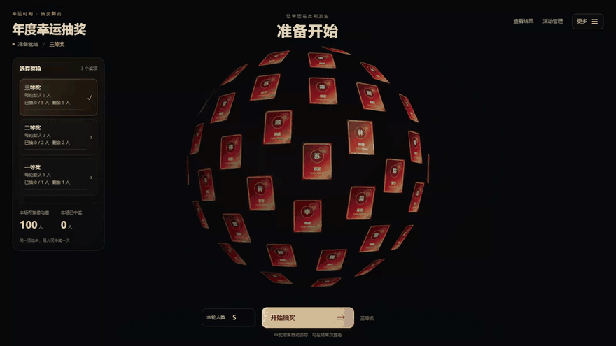
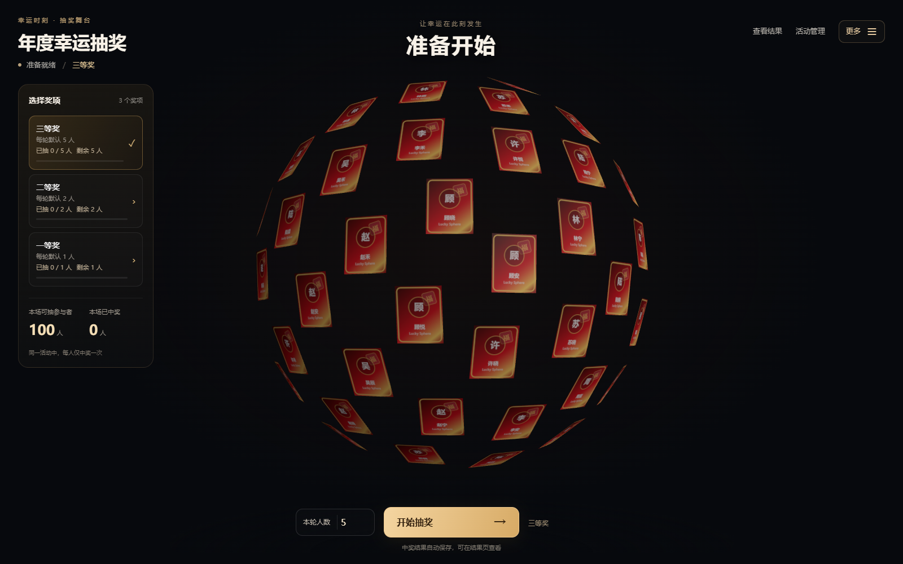
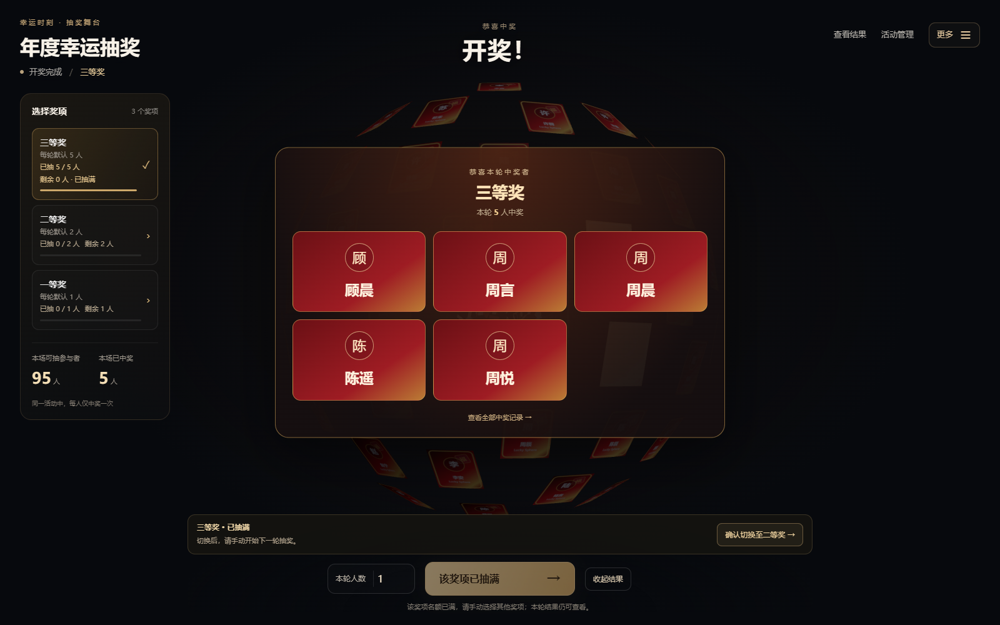
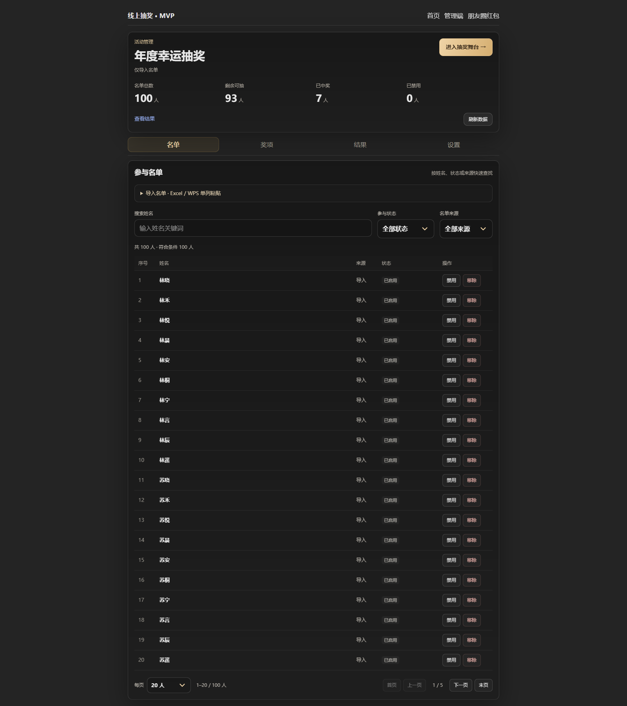
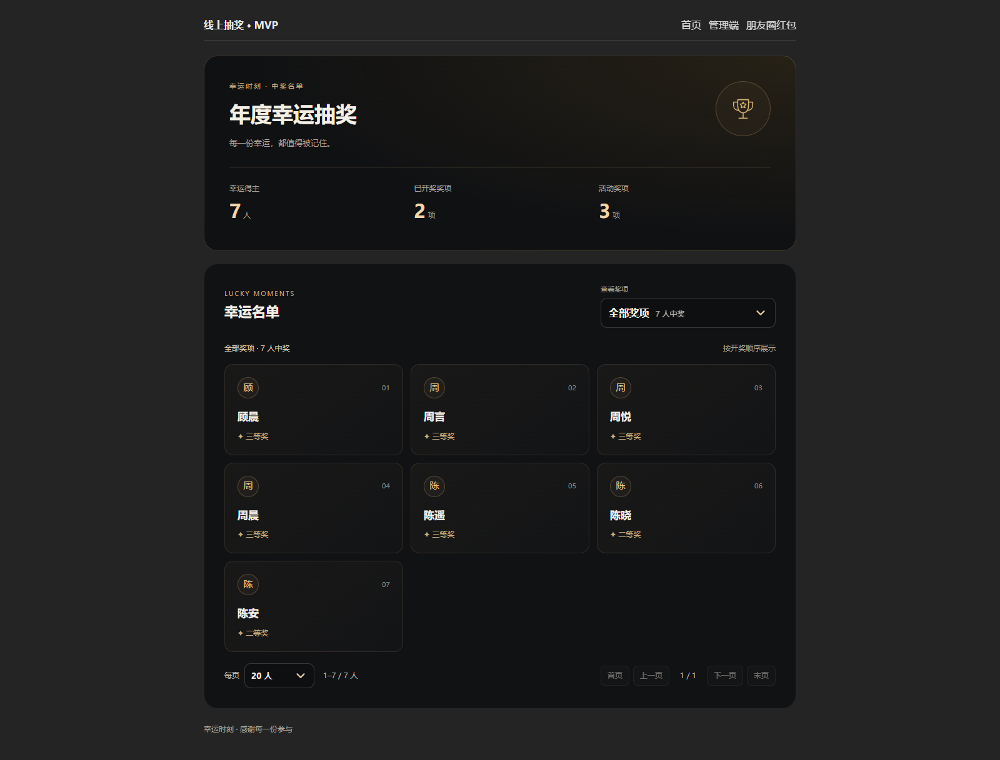

# Lucky Sphere · 3D 抽奖案例

面向年会、团队活动等主持场景的抽奖作品，覆盖名单准备、奖项配置、舞台开奖与结果查询。通过 3D 卡片球与清晰的主持人操作流程，让抽奖过程兼顾现场展示与后台管理。

**Vue 3 · TypeScript · Three.js · Fastify · Prisma · SQLite**

此目录用于案例展示。业务源码仓库为私有，本文通过功能说明、循环动图、界面截图和技术导览介绍实现。

## 一眼看懂

| 面向角色 | 主要操作 | 解决的问题 |
| --- | --- | --- |
| 活动组织者 | 导入名单、管理参与状态、配置奖项名额 | 提前准备活动，避免现场逐人操作 |
| 现场主持人 | 开始每轮抽奖、查看进度、确认切换奖项 | 保持主持节奏，避免自动进入下一轮 |
| 参与者与观众 | 观看开奖、查询允许公开的中奖结果 | 让结果展示清楚、便于后续查找 |

## 动态演示

18 秒循环演示：卡片球转动 → 三等奖多人开奖 → 主持人确认切换 → 二等奖开奖。使用本项目的真实操作录屏与虚构名单。

## 核心界面

### 3D 抽奖舞台

卡片球呈现参与者，左侧显示各奖项已抽与剩余名额，底部集中放置本轮人数和开始操作。历史中奖者通过亮色区分。

### 多人开奖与主持人确认

支持单人及多人开奖，抽满当前奖项后保留本轮结果。主持人确认切换后，仍需手动开始下一轮。

查看名单管理与公开结果

### 名单管理

支持 Excel / WPS 姓名列粘贴导入、导入预览与表头识别、同名提示，以及搜索、状态和来源筛选、分页查找。

### 中奖结果

管理端可核对中奖记录；允许公开时，观众可查看结果并按奖项筛选，长名单使用分页展示。

截图使用 100 人虚构活动，来自本地真实 API 和独立 SQLite 数据库。四张图分别记录准备、首轮开奖及两轮后结果，人数变化说明见 [截图说明](screenshots/README.md)。

## 一次活动怎样完成

1. **准备名单**：创建活动，粘贴姓名列，检查预览后导入；也可按活动需要开放报名。
2. **配置奖项**：分别设置累计总中奖名额和每轮默认人数，例如总名额 5 人、每轮 2 人。
3. **现场开奖**：主持人开始抽奖；末轮名额不足时按剩余人数收尾，上例为 2、2、1。
4. **确认下一奖项**：抽满后保留中奖展示，由主持人确认切换，不自动提交下一次开奖。
5. **结束与查询**：所有奖项已满或候选人耗尽时结束；管理端与结果页保留可查询记录。

同一活动每人最多中奖一次；同名人员通过不同身份区分。结果可设置公开或仅管理员可见。

## 技术亮点

- **交互状态清晰**：奖项进度统一计算，区分进行中、名额已满、待配置和结果待同步，避免界面显示与可操作状态脱节。
- **重复请求可恢复**：服务端保存开奖请求编号；相同请求重放原结果，网络响应不确定时按原请求恢复，减少重复开奖风险。
- **名额由后端约束**：候选人与剩余名额在 SQLite 写事务内重新校验，数据库唯一约束防止同一活动重复中奖。
- **视觉与管理兼顾**：WebGL 卡片球、历史中奖高亮与彩纸动效；后台提供分页、筛选、草稿保护及危险操作范围提示。
- **资源生命周期管理**：限制渲染像素比，页面退出时清理动画、尺寸观察器及图形资源。

更多设计取舍见 [精简技术导览](docs/technical-guide.md)。

## 验证范围与应用边界

已完成本地真实 100 / 300 人名单导入、开奖、结果查询及服务重启后的记录核对；另有累计名额、末轮缩量、主持人切换和请求重放验证。私有源码项目保留 18 项 API 自动回归，包含独立进程争抢名额等场景。

上述为本地功能验收，不作为线上并发容量或固定 FPS 承诺。当前采用共享管理口令；若用于持续运营，账号权限、操作审计、备份和部署方案需结合实际需求补齐。随机 seed 可用于复现，不等同于经过审计的公平性保证。

若讨论实际应用，可先明确活动人数、奖项规则、名单来源、展示设备、结果可见性和部署环境，再评估适配范围。当前案例不附带标准报价或上线交付承诺。

本目录包含展示文档、一张循环动图、四张正式截图与完整录屏素材，不提供业务源码、运行数据库、密钥或私有配置；无需安装依赖或启动服务。项目包含 AI 辅助开发，个人贡献与实现细节可在面试交流中按实际参与说明。